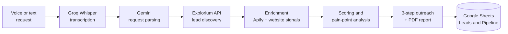

<div align='center'>


[](https://syed-waqar-portfolio.vercel.app/)
[](https://www.linkedin.com/in/syed-waqar-ali-zaidi-295b7339a/)
[](https://drive.google.com/file/d/1iU5zUy69jLdkzqNBXaW-eDJBfYzs2LI4/view?usp=sharing)
[](https://leetcode.com/u/SyedWaqarAliZaidi/)
[](mailto:zaidialiwaqarsyed2006@gmail.com)

<a href='#about'>About</a> &nbsp;·&nbsp;
<a href='#featured-projects'>Projects</a> &nbsp;·&nbsp;
<a href='#technical-expertise'>Expertise</a> &nbsp;·&nbsp;
<a href='#services'>Services</a> &nbsp;·&nbsp;
<a href='#experience'>Experience</a> &nbsp;·&nbsp;
<a href='#achievements'>Achievements</a> &nbsp;·&nbsp;
<a href='#education-and-certifications'>Education</a> &nbsp;·&nbsp;
<a href='#github-analytics'>Analytics</a> &nbsp;·&nbsp;
<a href='#contact'>Contact</a>

</div>

<br/>

## About

I am a **BS Artificial Intelligence** student at the **University of Karachi**, focused on multi-agent AI systems and production automation engineering. My work centers on designing agentic workflows, orchestrating LLM-driven pipelines, and shipping real automation for paying clients — not just classroom projects.

At **Radiant Solutions RS**, I deployed 15+ AI automation workflows in production, architected a full B2B lead-generation system, and managed Oracle Cloud VPS infrastructure end-to-end. Since March 2026 I have been building my own AI automation business as an independent engineer, and I have competed in multiple hackathons, building multi-agent systems and full-stack apps from scratch in days, not weeks.

<div align='center'>
<table>
<tr>
<td align='center' width='25%'><h3>15+</h3>production workflows<br/>deployed</td>
<td align='center' width='25%'><h3>40–60%</h3>client operational<br/>cost reduction</td>
<td align='center' width='25%'><h3>4</h3>hackathon builds<br/>shipped</td>
<td align='center' width='25%'><h3>3–6</h3>agents orchestrated<br/>per system</td>
</tr>
</table>
</div>

| At a glance | |
|:---|:---|
| **Based in** | Karachi, Pakistan |
| **Studying** | BS Artificial Intelligence, University of Karachi (Jan 2025 — present) |
| **Working as** | Independent AI Automation Engineer (since March 2026) |
| **Previously** | AI Automation Engineer & Business Executive, Radiant Solutions RS |
| **Core focus** | Multi-agent systems · workflow automation · LLM pipelines · self-hosted AI infrastructure |
| **Currently** | Building agentic automation pipelines and strengthening DSA fundamentals in C++ |
| **Open to** | Freelance automation projects · AI Engineer / Agentic Systems roles · SWE internship (Summer 2027) |

<br/>

## Featured Projects

| | |
|:---|:---|
| **[🛡️ Tahaffuz](https://github.com/SyedWaqarAliZaidi/TAHAFFUZ-DIGITAL-WEB_APP)**<br/>*Journey-safety web app for Pakistan*<br/><br/>A personal safety PWA built for CODE//CONNECT'26. Guardians join through a link with no install, alerts go out over WhatsApp via the Meta Cloud API with web-push fallback, and maps run on OpenStreetMap.<br/><br/>`Node.js` `PWA` `OpenStreetMap` `WhatsApp Cloud API` `Render`<br/><br/>[Live demo](https://tahaffuz-digital.onrender.com/) · [Source code](https://github.com/SyedWaqarAliZaidi/TAHAFFUZ-DIGITAL-WEB_APP) | **[🎓 ScholarFind](https://github.com/SyedWaqarAliZaidi/buildbyte-byteforge)**<br/>*AI scholarship matcher*<br/><br/>Reads a student's profile and finds the scholarships and grants they qualify for. Built solo for the BuildByte hackathon organized by IEEE SB NED.<br/><br/>`TypeScript` `Gemini API` `Vercel`<br/><br/>[Source code](https://github.com/SyedWaqarAliZaidi/buildbyte-byteforge) |
| **[🏰 Chronicles of Eldervale](https://github.com/SyedWaqarAliZaidi/chronicles-eldervale-)**<br/>*Multi-agent fantasy RPG*<br/><br/>A 6-agent fantasy RPG grounded in Microsoft Foundry IQ, with 24 grounded lore chunks and a 7-step reasoning pipeline. Built for the Microsoft Agents League Hackathon.<br/><br/>`Python` `Flask` `Groq LLaMA 3.3 70B` `Foundry IQ`<br/><br/>[Source code](https://github.com/SyedWaqarAliZaidi/chronicles-eldervale-) | **[🎮 The Warden's Labyrinth](https://github.com/SyedWaqarAliZaidi/AI-Warden-Run-Google-AI-Hackathon)**<br/>*AI adaptive mobile game*<br/><br/>A cyberpunk adaptive game with 3 simultaneous AI agents and an edge-deployed real-time backend, built in 5 days for Google's AISeekho 2026 Hackathon.<br/><br/>`React` `TanStack Start` `Vite` `Cloudflare Workers`<br/><br/>[Source code](https://github.com/SyedWaqarAliZaidi/AI-Warden-Run-Google-AI-Hackathon) |
| **[🌌 3D Space Portfolio](https://github.com/SyedWaqarAliZaidi/waqar-portfolio)**<br/>*Interactive developer portfolio*<br/><br/>A 3D space-themed portfolio with planets for About, Projects, and Client Work, and an asteroid belt linking out to LinkedIn, GitHub, and email.<br/><br/>`HTML` `Vercel`<br/><br/>[Live site](https://syed-waqar-portfolio.vercel.app/) · [Source code](https://github.com/SyedWaqarAliZaidi/waqar-portfolio) | **[🚗 Car Price Prediction](https://github.com/SyedWaqarAliZaidi/Data-Science-Projects)**<br/>*ML & exploratory data analysis*<br/><br/>End-to-end ML pipeline analyzing 19,000+ car records and comparing five regression models. Random Forest achieved the lowest Mean Absolute Error.<br/><br/>`Python` `Scikit-learn` `XGBoost` `Pandas`<br/><br/>[Source code](https://github.com/SyedWaqarAliZaidi/Data-Science-Projects) |

### Flagship: B2B Lead Generation Automation

A full pipeline for lead discovery, AI scoring, and personalized outreach. I closed my first independent client on this system. It takes a voice or text request, enriches and scores leads, writes pain-point analysis, a PDF report, and a 3-step LinkedIn outreach sequence, then logs everything to Google Sheets.



<sub>Architecture of the current rebuild, running on n8n hosted on my own Oracle Cloud VPS.</sub>

`n8n` `Claude AI` `Gemini` `Groq Whisper` `Explorium API` `Apify` `Google Sheets CRM`

<details>
<summary><b>More projects</b></summary>
<br/>

**👷 Mazdoori Digital** — A marketplace concept connecting daily-wage workers and skilled tradespeople with local customers in Karachi. Prototype built.

</details>

<br/>

## Technical Expertise

### Focus Areas

| Area | What I do |
|:---|:---|
| **Multi-Agent Orchestration** | Design 3–6 agent systems with role-based dispatch, shared state, and dynamic trust logic across hackathon builds |
| **Workflow Automation** | n8n and API integrations — 15+ production workflows deployed for enterprise clients, cutting operational costs by 40–60% |
| **Voice-to-Workflow Pipelines** | Voice or text request, Whisper transcription, LLM parsing, then lead enrichment, scoring, and outreach written straight to Google Sheets |
| **LLM Integration** | Claude, Gemini, Groq LLaMA 3.3 70B, OpenRouter — prompt design, grounded retrieval, and agent-to-agent reasoning pipelines |
| **Infrastructure** | Oracle Cloud VPS, Docker, Nginx, Cloudflare tunnels, and self-hosted LLMs via Ollama, managed end-to-end in production |
| **Problem Solving** | Building DSA fundamentals in C++, tracked openly in my [DSA repository](https://github.com/SyedWaqarAliZaidi/DSA) |

### Technology Stack

| Category | Technologies |
|:---|:---|
| **Languages** |       |
| **AI & LLMs** |        |
| **Automation & Agents** |      |
| **Web & Backend** |      |
| **Cloud & DevOps** |          |
| **Data Science** |      |

<br/>

## Services

I build **AI agents, n8n / Zapier workflows, and business process automation** for real businesses.

| Offering | What you get |
|:---|:---|
| **AI agents** | Agents that take real actions across your tools, built around your workflow |
| **Workflow automation** | n8n and Zapier pipelines for lead generation, reporting, notifications, and data sync |
| **Voice-to-workflow** | Speak or type a request and a pipeline carries it out end to end |
| **Self-hosted AI** | A private AI stack on your own VPS: n8n, Ollama, Docker, Nginx |

### The 7-Day Pilot

1. **Scope** — we pick one workflow worth automating.
2. **Build** — I build it within seven days, at my own cost.
3. **Test** — you run it on your real work.
4. **Decide** — continue together, or walk away with no obligation.

<div align='center'>

[](https://syed-waqar-portfolio.vercel.app/)
[](https://www.linkedin.com/in/syed-waqar-ali-zaidi-295b7339a/)
[](mailto:zaidialiwaqarsyed2006@gmail.com)

</div>

<br/>

## Experience

### Independent AI Automation Engineer
**Freelance** · Karachi, Pakistan · `Mar 2026 — Present`

- Building an independent AI automation business: AI agents, n8n workflows, and business process automation
- Closed my first independent client and offer a 7-day pilot build so clients can test a working workflow first
- Run self-hosted AI infrastructure on an Oracle Cloud VPS: n8n, Ollama (Llama 3.1), Open WebUI, and an AI agent managed over Discord
- Rebuilding my B2B lead-generation pipeline with voice/text input, direct API enrichment, and automated outreach

`n8n` `Python` `Gemini` `Docker` `Oracle Cloud` `Ollama`

### AI Automation Engineer & Business Executive
**Radiant Solutions RS (Pvt) Ltd** · Karachi, Pakistan · `Oct 2025 — Mar 2026`

- Designed and deployed 15+ AI automation workflows using n8n and Zapier for enterprise clients
- Reduced client operational costs by 40–60% through intelligent process automation
- Built a complete B2B Lead Generation pipeline integrating Claude AI, Gemini, and Google Sheets CRM
- Architected and managed Oracle Cloud VPS, Docker, SSH tunneling, and local LLM deployment via Ollama

`Python` `n8n` `Claude AI` `Docker` `Oracle Cloud` `Ollama`

<br/>

## Achievements

| Recognition | Details |
|:---|:---|
| **Google AISeekho 2026 Hackathon** | Built a multi-agent AI mobile game in 5 days with a 3-person team |
| **Microsoft Agents League Hackathon** | Built a 6-agent reasoning RPG grounded in Foundry IQ |
| **BuildByte Hackathon (IEEE SB NED)** | Built and shipped ScholarFind, an AI scholarship matcher, solo |
| **CODE//CONNECT'26 Hackathon** | Built and deployed Tahaffuz, a journey-safety web app with WhatsApp alerts |
| **Independent Client Acquisition** | Acquired and delivered for independent clients in AI automation |
| **Production Impact** | Deployed 15+ workflows reducing client costs by 40–60% |
| **GDGoK Member** | Active member, Google Developer Groups on Campus — University of Karachi |

<br/>

## Education and Certifications

| Credential | Issuer | Details |
|:---|:---|:---|
| **BS Artificial Intelligence** | University of Karachi | Jan 2025 — present · Python, C/C++, DSA, OOP, Discrete Structures |
| **Data Science** | NED University | Certification |
| **Generative AI** | Google | Certification |
| **Large Language Models** | Google | Certification |
| **AI Agents** | Google | Certification |
| **IELTS** | — | 7 bands |

<br/>

## GitHub Analytics

<div align='center'>

<picture>
  <source media='(prefers-color-scheme: dark)' srcset='https://github-readme-stats.vercel.app/api?username=SyedWaqarAliZaidi&show_icons=true&theme=tokyonight&hide_border=true&bg_color=00000000'>
  
</picture>
<picture>
  <source media='(prefers-color-scheme: dark)' srcset='https://streak-stats.demolab.com/?user=SyedWaqarAliZaidi&theme=tokyonight&hide_border=true&background=00000000'>
  
</picture>
<picture>
  <source media='(prefers-color-scheme: dark)' srcset='https://github-readme-stats.vercel.app/api/top-langs/?username=SyedWaqarAliZaidi&layout=compact&theme=tokyonight&hide_border=true&bg_color=00000000'>
  
</picture>

<br/><br/>

<picture>
  <source media='(prefers-color-scheme: dark)' srcset='https://github-profile-trophy.vercel.app/?username=SyedWaqarAliZaidi&theme=tokyonight&no-frame=true&row=1&column=7'>
  
</picture>

<br/><br/>


<sub>Stats are live from the GitHub API. The contribution snake regenerates daily via GitHub Actions.</sub>

</div>

<br/>

## Contact

| Channel | Link |
|:---|:---|
| **Portfolio** | [syed-waqar-portfolio.vercel.app](https://syed-waqar-portfolio.vercel.app/) |
| **LinkedIn** | [syed-waqar-ali-zaidi](https://www.linkedin.com/in/syed-waqar-ali-zaidi-295b7339a/) |
| **Email** | [zaidialiwaqarsyed2006@gmail.com](mailto:zaidialiwaqarsyed2006@gmail.com) |
| **Resume** | [View on Google Drive](https://drive.google.com/file/d/1iU5zUy69jLdkzqNBXaW-eDJBfYzs2LI4/view?usp=sharing) |
| **LeetCode** | [SyedWaqarAliZaidi](https://leetcode.com/u/SyedWaqarAliZaidi/) |
| **Radiant Solutions** | [radiantsolutionsrs.com](https://radiantsolutionsrs.com) |

```yaml
current_focus:
  building: Agentic automation pipelines · Freelance automation projects · DSA fundamentals in C++
  exploring: MCP server ecosystems · self-hosted LLM infrastructure
  open_to: AI Engineer · Agentic Systems Developer · AI Automation Engineer · SWE Internship (Summer 2027)
```

<div align='center'>

</div>
